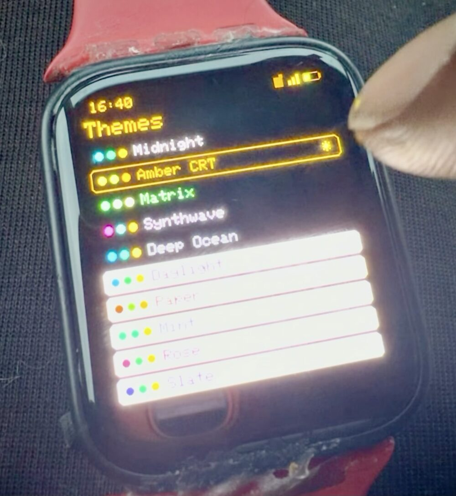
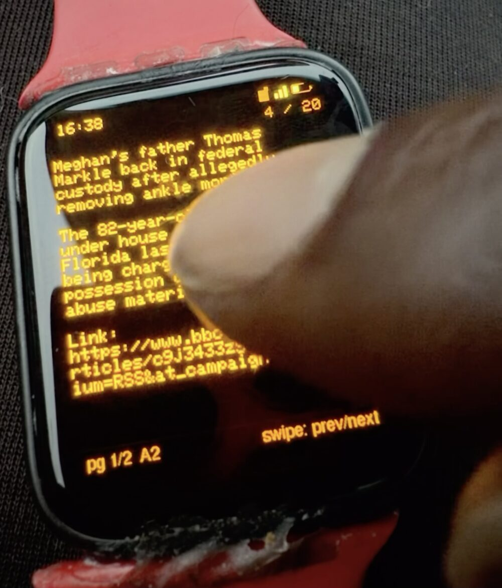
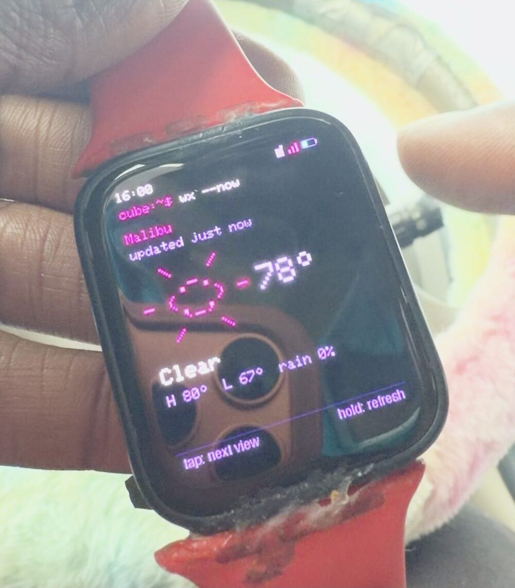

# Little Cube OS

**A calm little operating system for a wrist-sized AMOLED computer.**
Arduino/C++ firmware for the Waveshare ESP32-S3-Touch-AMOLED-1.8.

<table>
  <tr>
    <td align="center" width="33%"></td>
    <td align="center" width="33%"></td>
    <td align="center" width="33%"></td>
  </tr>
  <tr>
    <td align="center"><b>10 themes</b><br>five dark, five light</td>
    <td align="center"><b>News</b><br>BBC headlines, paged for a tiny screen</td>
    <td align="center"><b>Weather</b><br>current, high/low, rain chance</td>
  </tr>
</table>

Little Cube OS turns the board into a small, calm personal information device.
It is built for quick glances and focused actions, not for becoming a tiny
smartphone. The touchscreen is the calm interface; **USB serial is the
keyboard**.

- Check the time, weather, calendar, news, and a daily overview.
- Read and write notes, browse files, and manage contacts.
- Record a voice note, review its transcription, and save the approved text as a normal note.
- Play recordings, music, and podcasts, or stream live MP3 internet radio from editable station presets.
- Play `.lcv` video clips from the SD card.
- Ask the assistant questions using the cube's microphone and speaker.
- Pick a theme, and let the burn-in protection quietly shift the chrome around.

Your content lives on the microSD card. Wi-Fi powers the connected features
(weather, news, time sync, assistant). Everything is designed to keep working,
or fail with a specific message, when Wi-Fi or the card is missing.

## Hardware

Built for exactly one board: the **Waveshare ESP32-S3-Touch-AMOLED-1.8**.

| | |
|---|---|
| MCU | ESP32-S3R8, 8 MB OPI PSRAM, 16 MB flash |
| Display | SH8601 368x448 AMOLED (QSPI) |
| Touch | FT3168 |
| Audio | ES8311 codec, microphone + speaker |
| Storage | microSD (SD_MMC, 1-bit) |
| Power / clock | AXP2101 PMU + battery, PCF85063 RTC |

It is not a generic ESP32 application; the pins, panel init, and audio path
are specific to this module. You also need a microSD card and a USB-C cable.

## Quick start

### 1. Build and flash

Little Cube OS uses **Arduino CLI only** (no PlatformIO, CMake, or ESP-IDF).

```bash
# once: Arduino CLI + ESP32 core 3.3.8 + libraries
brew install arduino-cli           # macOS
./scripts/install-libraries.sh

# tell the scripts which board option set and USB port to use
export LITTLECUBE_FQBN="esp32:esp32:esp32s3:FlashSize=16M,PSRAM=opi,USBMode=hwcdc,CDCOnBoot=cdc,PartitionScheme=custom"
export LITTLECUBE_PORT="/dev/cu.usbmodem101"   # find yours: arduino-cli board list

./scripts/build.sh      # compile (all warnings) into dist/
./scripts/upload.sh     # flash; handles the 1200-baud USB reset
./scripts/monitor.sh    # serial console at 115200
```

Every FQBN option matters, `PSRAM=opi` above all: the frame buffer lives in
PSRAM. If an upload fails, unplug and replug the cube, or hold **BOOT** while
plugging it in. Details: [docs/arduino-cli-setup.md](docs/arduino-cli-setup.md).

> **Platform note:** `upload.sh` uses macOS `stty -f` and `/dev/cu.usbmodem*`
> port names. On Linux you will need to adapt the reset step (touch the port at
> 1200 baud, then upload to the re-enumerated port yourself).

### 2. Insert a microSD card

Use a FAT-formatted microSD card. The firmware keeps user content under
`/littlecube/` (notes, recordings, music, podcasts, radio presets, video,
calendar, contacts, exports). If the tree is missing, `storage index`
recreates it. The cube still boots without a card; SD features then report the
specific card state (`not present`, `read-only`, `full`, ...).

### 3. Connect to Wi-Fi

Wi-Fi is optional, but weather, news, time sync, podcasts, radio, and the
assistant all need it. There are two ways to join a network, and your Wi-Fi
password is never written to the SD card or printed to the console.

**Option A: phone setup (no computer needed)**

1. On the cube open **Settings -> Wi-Fi -> Phone setup**.
2. The screen shows a temporary hotspot name (`LittleCube-XXXX`) and a random
   one-time password. Join that hotspot from your phone.
3. Open **192.168.4.1** in the phone's browser, pick your network, enter the
   password, and save. The cube connects, remembers the network, and shuts the
   hotspot down. Press BOOT (or swipe right) to cancel setup.

**Option B: USB serial**

Open the serial console (`./scripts/monitor.sh`, or any terminal at 115200
baud) and type:

```text
wifi scan                       # list nearby networks
wifi connect "My Network"       # the NEXT line you type is the password
wifi connect "Cafe WiFi" open   # open network, no password
wifi connect "Hidden Net" hidden
wifi status                     # state, SSID, signal, IP
```

The cube prints `Password:` and treats your next line as the password. It
never echoes or logs it, but **your terminal may still show what you type**,
and saved credentials sit in NVS flash, which is not encrypted on this board.
Use `wifi forget "<ssid>"` to remove a saved network and `wifi offline on|off`
to kill or restore the radio.

### 4. Make it yours

```text
settings set weather.city Malibu     # weather location (geocoded over Wi-Fi)
settings set timezone PST8PDT,M3.2.0,M11.1.0   # POSIX TZ string (US Pacific here)
time set 2026-07-31 16:40            # only if you are offline; otherwise it syncs
settings themes                      # list the 10 palettes
settings set theme "Amber CRT"       # by name, or 0-9
settings set brightness 120          # 16-255
news refresh                         # pull the latest BBC headlines
assistant key                        # store an OpenAI API key (assistant)
assistant ask what is the tallest mountain
```

The weather, news and themes screens in the photos above came from exactly
this setup. See [Serial commands](#serial-commands) for the rest.

## Controls

| Input | What it does |
|---|---|
| Tap / swipe | Navigate and act inside an app (the footer of each screen shows its hints, e.g. `tap: next view`, `hold: refresh`, `swipe: prev/next`) |
| **BOOT** short press | Back (many screens also accept a swipe; check the footer hint) |
| **BOOT** long press | Home |
| Touch while the screen is dark | Designed to wake it without triggering what is under your finger |

Anything destructive (delete, stop recording, eject) always has a visible
on-screen control, never just a gesture.

## Apps

Home, Today, Clock, Weather, Calendar, Notes, Recorder, Assistant, Audio
(music, podcasts, radio, recordings), Files, Contacts, Calculator, Settings,
Reader, News, and Video. From serial, `open <app>` drives the same router the
touchscreen does.

## Serial commands

USB serial is where you type. Connect at **115200 baud**; the boot banner ends
with `boot: ready`. The grammar is always `family verb args...`, lines are
capped at 255 characters, and `help` / `help <family>` prints the built-in
reference.

```text
help                  command index          help wifi    one family in detail
status                firmware, uptime, heap/PSRAM, Wi-Fi, SD, battery, clock
version  uptime  reboot
open <app>            open an app by name    back         go back one screen
time                  show the clock         time set YYYY-MM-DD HH:MM[:SS]
```

| Family | Handy commands |
|---|---|
| `wifi` | `scan`, `connect "<ssid>" [open\|hidden]`, `status`, `disconnect`, `forget "<ssid>"`, `offline on\|off` |
| `settings` | `list`, `get <key>`, `set <key> <value>`, `themes`, `bedtime <on\|off> [HH:MM HH:MM] [brightness]` |
| `news` | `list`, `show <n>`, `refresh` |
| `notes` | `list`, `show <id>`, `new`, `write <file>`, `append <id>`, `rename`, `pin`, `favorite`, `delete <id> confirm`, `export`, `import` |
| `files` | `list`, `tree`, `cat`, `mkdir`, `copy`, `move`, `rename`, `delete <path> confirm` |
| `storage` | `status`, `mount`, `eject` (wait for `safe to remove the card`), `index` |
| `recordings` | `list`, `start`, `stop`, `gain`, `normalize`, `gate`, `info`, `rename`, `delete <id> confirm` |
| `audio` / `volume` | `audio list/play/pause/resume/stop/next/previous`, `volume <0-100>` |
| `radio` | `list`, `add "Name" "http://..."`, `remove`, `play <id>`, `pause`, `resume`, `stop`, `status` |
| `podcast` | `feeds`, `add <rss-url>`, `remove`, `fetch`, `status`, `list` |
| `video` | `list`, `play <path.lcv>`, `pause`, `resume`, `seek`, `stop`, `status`, `queue` |
| `assistant` | `status`, `key`, `mode [api\|realtime]`, `ask <question>`, `voice`, `transcribe <wav>`, `reset` |
| `calendar` | `list`, `show`, `next`, `add`, `done`, `delete <id> confirm`, `export`, `import` |
| `contacts` | `list`, `search`, `show`, `add`, `set`, `favorite`, `delete <id> confirm`, `export`, `import` |

Multi-line input (`notes new`, `notes write`, `notes append`) switches the
console into capture mode: finish with `.END`, discard with `.CANCEL`. A failed
save never discards your text. Destructive commands require a literal
`confirm`. Every path is sanitized and confined to `/littlecube` (plus the
`/cypher-puter/desk` interop folder).

Full syntax, edge cases, and safety properties: [docs/serial-interface.md](docs/serial-interface.md).

## Project status

Little Cube OS is under active development, and the docs are deliberately
strict about what counts as "working". Recording, playback, microphone capture,
and the assistant flows have been checked on the physical cube, and the screens
in the photos above are running on real hardware. Many other behaviors
(Wi-Fi edge cases, SD removal/recovery, power loss, burn-in protection timing)
are still unchecked on the validation list. A clean build is not validation;
see [docs/hardware-validation.md](docs/hardware-validation.md) for the actual
evidence.

## Learn more

- [technical.md](technical.md): setup, architecture, and development
- [docs/product-spec.md](docs/product-spec.md): the product contract
- [docs/serial-interface.md](docs/serial-interface.md): every serial command
- [docs/arduino-cli-setup.md](docs/arduino-cli-setup.md): toolchain and upload quirks
- [docs/lcv-format.md](docs/lcv-format.md): the `.lcv` video format (`scripts/pack-video.sh` makes them)
- [docs/amoled-protection.md](docs/amoled-protection.md): burn-in defense
- [docs/hardware-validation.md](docs/hardware-validation.md): what has been tested on the device
- [AGENTS.md](AGENTS.md): contributor guidelines
